<div align="center">

# Pokémon Reloaded para Android

**El juego original de PC, ejecutado de forma nativa en tu móvil. Sin Wine, sin emulación de Windows.**

[](../../releases/latest)
[](LICENSE)


[Descargar](../../releases/latest) · [Capturas](#capturas) · [Cómo se usa](#cómo-se-usa) · [Funciones](#funciones) · [Compilar](#compilar-desde-el-código) · [Historial](#historial-de-versiones)

</div>

---

## Índice

1. [Qué es](#qué-es)
2. [Capturas](#capturas)
3. [Cómo se usa](#cómo-se-usa)
4. [Funciones](#funciones)
5. [Rendimiento y fotogramas por segundo](#rendimiento-y-fotogramas-por-segundo)
6. [Arquitectura](#arquitectura)
7. [Estructura del repositorio](#estructura-del-repositorio)
8. [Compilar desde el código](#compilar-desde-el-código)
9. [Firma y actualizaciones](#firma-y-actualizaciones)
10. [Herramientas de diagnóstico](#herramientas-de-diagnóstico)
11. [Historial de versiones](#historial-de-versiones)
12. [Estado y problemas conocidos](#estado-y-problemas-conocidos)
13. [Licencia y créditos](#licencia-y-créditos)

---

## Qué es

**Pokémon Reloaded** es un juego de fans hecho en **Game Maker 8** para Windows. Esta aplicación lo
ejecuta en Android **tal cual**: con sus archivos originales intactos, sin reescribirlo ni
recompilarlo. Para ello se apoya en [OpenGMK](https://github.com/OpenGMK/OpenGMK), una
reimplementación nativa, escrita en Rust, del motor de Game Maker 8.

No hay Wine, ni Windows emulado, ni capa de traducción: el motor se compila para el procesador del
móvil y el juego corre prácticamente como un programa nativo. Lo único que se ha portado son las
tripas del motor, no el juego.

Todo lo que rodea al juego lo aporta la app: importación desde un `.zip`, controles táctiles
adaptados a cada pantalla, gestión de partidas, ajustes, actualizaciones y registros.

Este proyecto parte del port de [@Klisee](https://github.com/Klisee)
([pokemon-reloaded-android](https://github.com/Klisee/pokemon-reloaded-android)) y lo desarrolla en una
línea propia, con otro paquete (`com.ahjin.pr`), firma propia, nueva interfaz y numerosas mejoras
de audio, controles, rendimiento y extras. Los controles táctiles cambian solos según la pantalla
(mochila, mapa, equipo, combate…) y muestran solo los botones que hacen falta.

> **El juego no está incluido.** El repositorio no contiene ningún recurso de Pokémon Reloaded; lo
> importas tú a partir del `.zip` oficial.

## Capturas

Capturas reales de la versión **0.7.2** en un RedMagic 8S Pro. La app también se ha probado en un Samsung Galaxy S21 5G y en un Samsung Galaxy A53 5G. En las de juego se ve el indicador de
rendimiento (FPS, milisegundos por fotograma y memoria) activado.

### En el juego

<table>
  <tr>
    <td width="50%"><br><sub><b>Exploración.</b> Joystick de 8 direcciones, botones translúcidos con el arte del propio juego y los accesos del sistema (guardar, cargar y avance rápido) a la izquierda.</sub></td>
    <td width="50%"><br><sub><b>Combate.</b> Atacar con Z X C V, la rueda <b>SEL</b> para cambiar de Pokémon, bola, huir y reloj. El botón de la derecha abre la tabla de tipos.</sub></td>
  </tr>
  <tr>
    <td width="50%">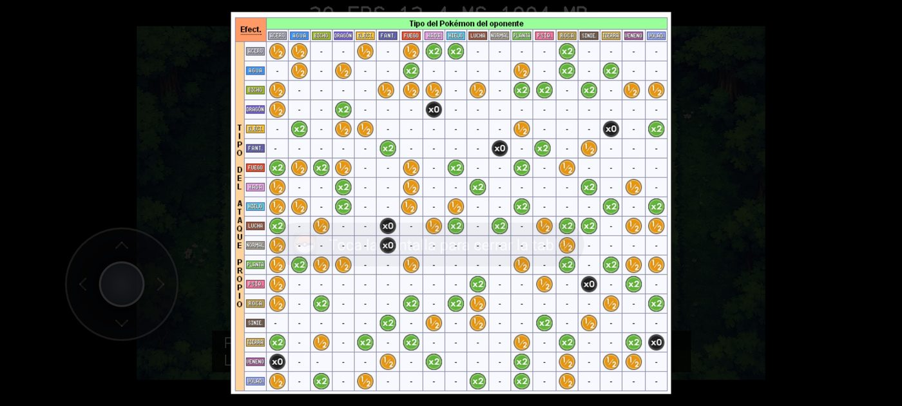<br><sub><b>Tabla de tipos.</b> La imagen de efectividades del propio juego, con el juego detenido; un toque la cierra.</sub></td>
    <td width="50%">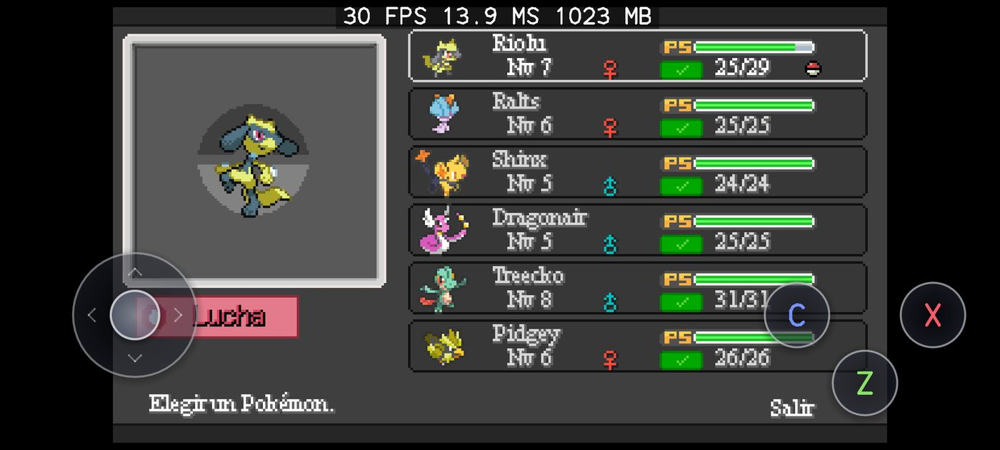<br><sub><b>Equipo Pokémon.</b> Solo joystick, <b>Z</b>, <b>X</b> y <b>C</b> (ordenar): nada del mapa encima.</sub></td>
  </tr>
  <tr>
    <td width="50%">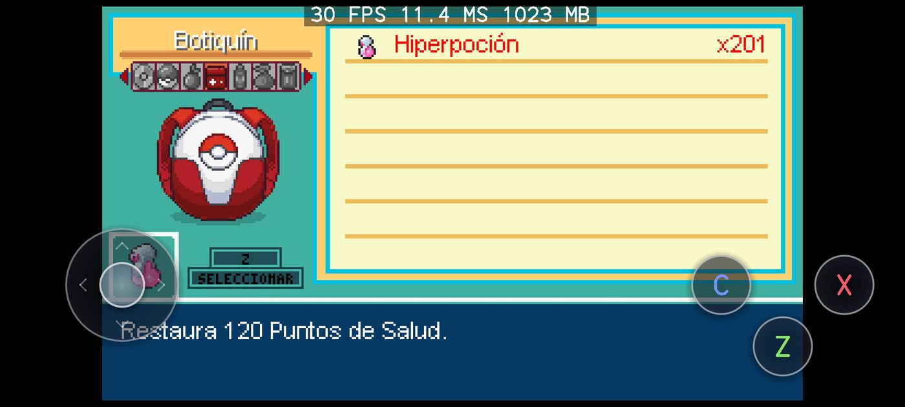<br><sub><b>Mochila.</b> Misma idea: los botones del mundo desaparecen y quedan los que se usan.</sub></td>
    <td width="50%"></td>
  </tr>
</table>

### La aplicación

<table>
  <tr>
    <td width="25%">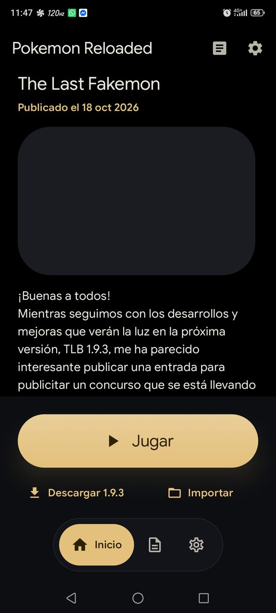<br><sub><b>Inicio.</b> Noticias del juego, <b>Jugar</b>, descargar o importar el .zip.</sub></td>
    <td width="25%">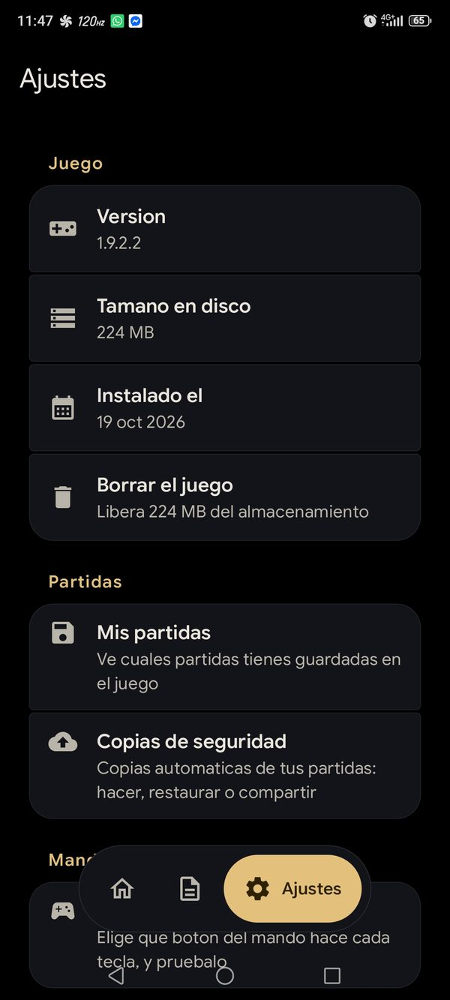<br><sub><b>Juego y partidas.</b> Versión instalada, espacio, <i>Mis partidas</i> y copias de seguridad.</sub></td>
    <td width="25%"><br><sub><b>Controles.</b> Aspecto nativo o pixel art, iconos en los botones y posición y tamaño.</sub></td>
    <td width="25%"><br><sub><b>Editor.</b> Una pestaña por pantalla (Mundo, Diálogos, Menús, Pantallas…), botones propios y especiales.</sub></td>
  </tr>
  <tr>
    <td width="25%">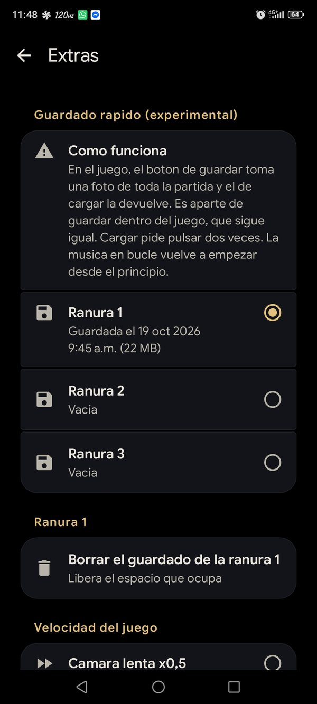<br><sub><b>Guardado rápido.</b> Tres ranuras, con fecha y tamaño.</sub></td>
    <td width="25%">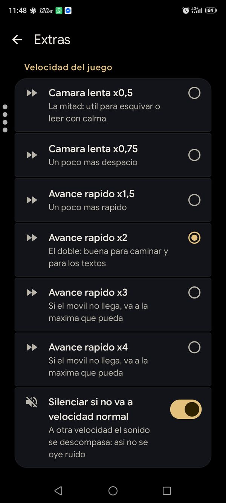<br><sub><b>Velocidad.</b> De cámara lenta ×0,5 a avance rápido ×4, con sonido silenciable.</sub></td>
    <td width="25%">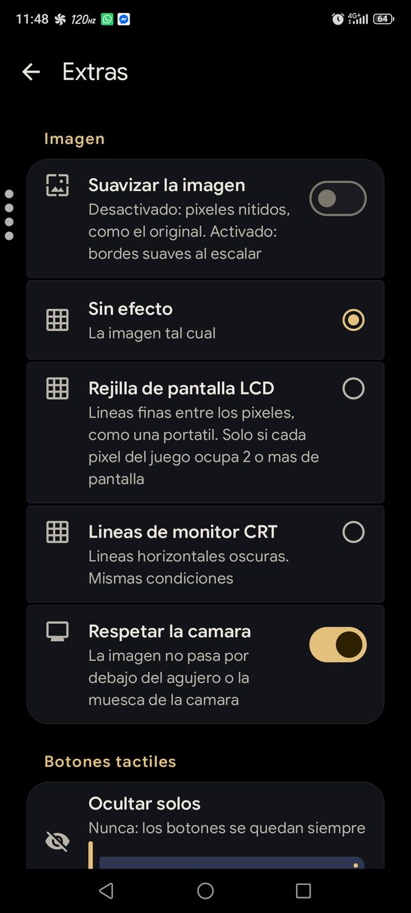<br><sub><b>Imagen.</b> Suavizado, rejilla LCD, líneas CRT y respeto de la cámara.</sub></td>
    <td width="25%">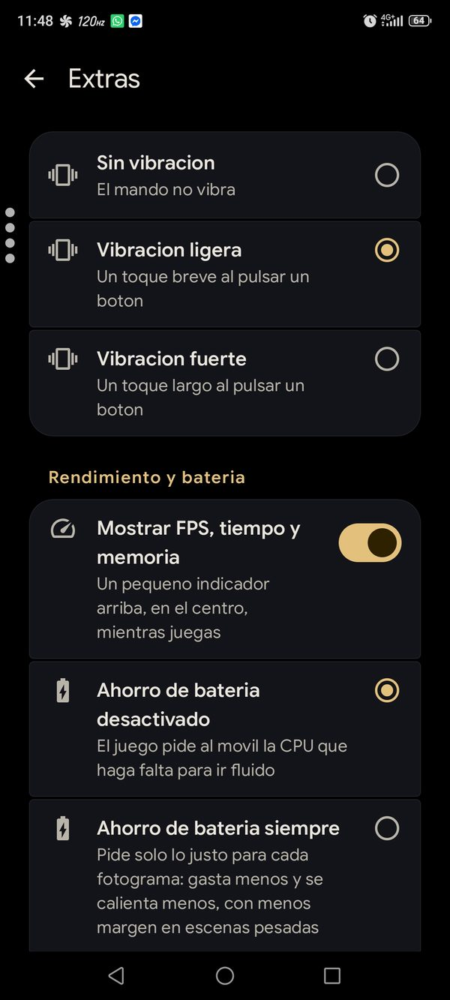<br><sub><b>Mando y rendimiento.</b> Vibración, indicador de FPS y ahorro de batería.</sub></td>
  </tr>
  <tr>
    <td width="25%"><br><sub><b>Resolución.</b> Rellenar, mantener la proporción o píxeles perfectos.</sub></td>
    <td width="25%">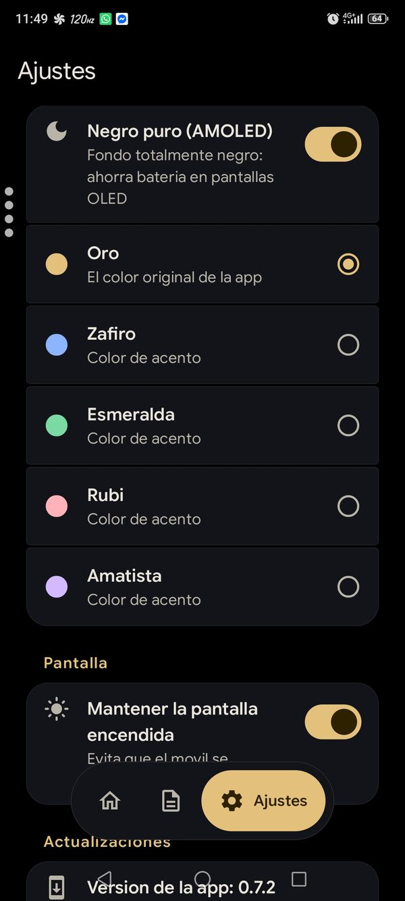<br><sub><b>Apariencia.</b> Oscuro, claro o sistema; acento de color y negro puro AMOLED.</sub></td>
    <td width="25%">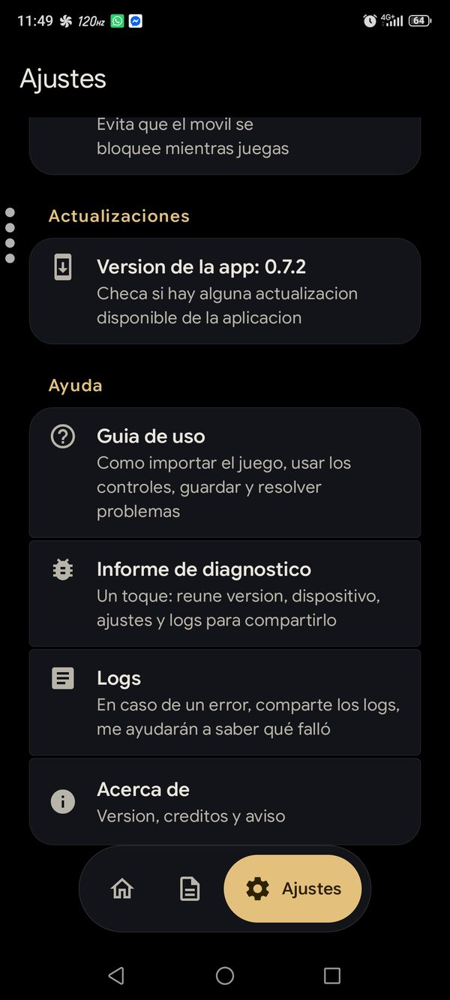<br><sub><b>Actualizaciones y ayuda.</b> Versión, guía de uso, informe de diagnóstico y logs.</sub></td>
    <td width="25%"></td>
  </tr>
</table>

## Cómo se usa

### Requisitos

- Android 10 o superior (API 29).
- Probado en RedMagic 8S Pro, Samsung Galaxy S21 5G y Samsung Galaxy A53 5G.
- Un procesador de 64 bits (arm64-v8a). El APK incluye también el motor de 32 bits (armeabi-v7a).
- El juego en un `.zip`, disponible en el [blog de F3R](https://pokemon-reloaded.blogspot.com/).
- Unos 350 MB libres para el juego descomprimido (el `.zip` pesa unos 200 MB).

### Instalación

1. Descarga el APK de la [última versión](../../releases/latest) e instálalo.
2. Abre la app y pulsa **Importar** para elegir el `.zip` del juego (o **Descargar**, que abre el enlace de la última versión del juego).
3. Pulsa **Jugar**.

También puedes mantener pulsado el `.zip` en tu administrador de archivos y elegir **Abrir con →
Pokemon Reloaded** (o **Compartir** con la app). La app mira dentro del zip, te dice si es el juego, un
conjunto de partidas o una sola partida, y no cambia nada hasta que confirmas. Sirve igual para el
juego, para las copias de seguridad y para una partida exportada (esta te deja elegir el slot).

Si ya jugabas en PC, tu partida entra desde **Ajustes → Partidas → Importar**.

> **Sobre el paquete.** La app usa el identificador `com.ahjin.pr`. Es independiente de cualquier
> versión anterior con otro identificador: se instala en paralelo, no la actualiza y no comparte datos
> con ella. A partir de aquí, las actualizaciones dentro de la app funcionan con normalidad.

## Funciones

### Controles táctiles

- **Se adaptan al juego.** La capa táctil cambia según lo que ocurre en pantalla (mapa, combate,
  diálogos, menús, elecciones, Zona Safari), de modo que cada situación muestra solo los botones
  que hacen falta. Detalle en [Botones según la pantalla](#botones-según-la-pantalla).
- **Aspecto nativo.** Botones translúcidos con borde suave, iconos y letras vectoriales,
  animación al pulsar y brillo del color de cada botón. Se puede volver al pixel art clásico del juego.
- **Iconos según la función.** Cada botón del juego muestra lo que hace en vez de su letra:
  mochila, mapa, bici, caña de pescar, correr, huir, entrenador, objeto asignado, equipo…
  El icono sigue a la situación (la tecla `M` es el mapa fuera de combate y la megaevolución en combate) y en
  combate `Z X C V` conservan su letra, porque ahí son los cuatro ataques. Se puede volver a las letras en
  **Ajustes → Aspecto de los controles → Iconos en los botones**.
- **Botones especiales** (se añaden en el editor): **correr fijo** (un toque deja `X` pulsada y otro la suelta),
  **turbo** (mantenerlo pulsa `Z` unas 7 veces por segundo), **velocidad del juego** (pasa de una velocidad a la
  siguiente) y **tabla de tipos**. Los botones propios pueden ser normales, turbo o fijos.
- **Joystick de 8 direcciones** en todo el juego, con diagonales con histéresis, zona muerta
  ajustable y modo flotante que sigue al pulgar.
- **Editor de posiciones y tamaños.** Arrastra, redimensiona u oculta cada botón por pantalla del
  juego. Admite **diseños guardados** con nombre.
- **Botones propios:** hasta 8, con la tecla, el texto de 3 letras **o uno de 32 iconos** (los de arriba,
  flechas, estrella, corazón, pausa, tabla…) y las pantallas que elijas.
- **Preajustes de disposición:** Estándar, Zurdo, Compacto, Grande y Zurdo compacto, con
  confirmación antes de aplicarlos. No tocan los botones propios ni los que hayas ocultado.
- **Respuesta táctil cuidada:** deslizar de un botón a otro sin levantar el dedo, vibración
  ajustable (apagada, ligera, fuerte), difuminado de los botones cuando no se usan y bordes de la
  pantalla excluidos del gesto «atrás» del sistema.
- **Tamaño y opacidad global** de los botones, joystick flotante y zona muerta del joystick desde
  **Ajustes**.
- **Mandos físicos:** detección automática, reasignación de teclas, vibración y atajos propios:
  guardado rápido, cargar, avance rápido, mostrar u ocultar los FPS y cambiar de ranura de guardado rápido.

### Botones según la pantalla

Cada pantalla enseña solo lo que sirve en ella. La app lee del juego en qué pantalla está (la sala, el
tipo de ventana que dibuja y los objetos que ha creado, como una tienda) y cambia la capa táctil sola.

| Pantalla | Botones |
| --- | --- |
| **Mundo** | Joystick, `Z`, `X`, `C` (caña), `V` (bici), números `1 2 3 5 7` (MO), equipo, mochila, mapa, `E`, `T`, `L`, `P`, `A`, `N`, OK, ESC y los accesos del sistema |
| **Combate** | Joystick, ataques `Z X C V`, `B` (bola), `S` (cambiar), rueda **SEL** (elegir Pokémon), equipo, mochila, mega, huir, reloj, `L`, `P`, OK, ESC y los accesos del sistema |
| **Zona Safari** | Como el mundo, más la bola, sin los ataques |
| **Mochila, equipo, Pokédex, mapa y misiones** | Joystick, `Z`, `X` y `C` (ordena la lista, o mueve el cursor del mapa) |
| **Movimientos, habilidades e información del Pokémon, entrenador, opciones, móvil, huevos, logros y torneo** | Joystick, `Z` y `X` |
| **Tiendas** (comprar, vender, canjear) **y PC de objetos** | Joystick, `Z` y `X` |
| **Diálogos** | Solo el botón que avanza (`Z`), para no tapar el texto |
| **Listas de opciones** | Joystick y `X`; las entradas se tocan directamente |
| **Preguntas Sí/No, caja del PC, teclado y menús del título** | Ninguno: se tocan directamente |
| **Elegir personaje** | Dos flechas, OK y `X` |
| **Preferencias del juego nuevo** | Joystick, `Z` y `X` |

Los botones de cada grupo se colocan en **Posición y tamaño de los botones**, una pestaña por grupo
(**Mundo**, **Diálogos**, **Menús**, **Pantallas**, **Combate**, **Safari**…). Un botón tiene una sola posición:
si lo mueves en una pestaña se mueve en todas en las que aparece.

Las minijuegos (casino, cartas, tragaperras) conservan de momento los botones del mundo.

### Audio

- Mezcla en un **hilo propio**. El callback de AAudio solo copia desde un búfer circular de unos
  60 ms, así que la música y los efectos no se cortan al mezclarse.
- Reapertura automática del dispositivo de audio, limitador suave contra saturación y
  preparación al cargar de los sonidos con frecuencia especial (los gritos).
- Si hubiera huecos, se registran en el log (`[aaudio] N huecos de audio`).
- Música MIDI sintetizada con SoundFont integrado.

### Imagen

- **Resolución:** rellenar la pantalla, mantener la proporción del PC con bandas o **píxeles perfectos**
  (múltiplos enteros, para un píxel nítido y uniforme).
- Filtro suave opcional, **rejilla LCD** y **líneas CRT**.
- Respeto de la muesca y la cámara frontal.

### Extras

Se configuran en **Ajustes → Extras**.

| Extra | Descripción |
| --- | --- |
| **Guardado rápido** | Tres ranuras independientes del guardado del juego. Guardar es un toque; cargar exige pulsar dos veces seguidas, para no perder progreso por error. El archivo se escribe aparte y se renombra, de modo que un fallo nunca estropea la ranura anterior. La música en bucle vuelve a empezar al cargar. |
| **Velocidad del juego** | **Cámara lenta** ×0,5 y ×0,75 y **avance rápido** ×1,5, ×2, ×3 y ×4, con el sonido silenciable fuera de la velocidad normal. Solo cambia la espera entre fotogramas: la lógica del juego no cambia. Se puede fijar en Extras o alternar con un botón especial. Si el móvil no llega, va a la máxima que pueda; el avance rápido se desactiva solo si se calienta mucho. |
| **Tabla de tipos** | Botón especial para combate que muestra la imagen de efectividades **del propio juego** sobre la partida. El juego se **detiene** mientras está abierta (el rival no ataca) y se cierra con un toque en la pantalla o con cualquier botón del mando. |
| **Correr fijo** | Botón especial: un toque deja `X` pulsada y otro la suelta. Se libera solo al abrir un menú, un diálogo o un combate. |
| **Botón turbo** | Botón especial: mientras lo mantienes, pulsa `Z` unas 7 veces por segundo (textos y menús a toda prisa). |
| **Atajos de Android** | Al mantener pulsado el icono de la app: **Continuar** (abre el juego directamente) y **Guardado rápido** (abre el juego y carga el guardado rápido; si el juego ya estaba abierto, solo lo trae al frente). |
| **Imagen** | Suavizado opcional, rejilla LCD, líneas CRT y respeto de la cámara frontal. |
| **Botones táctiles** | Ocultarse solos tras unos segundos sin tocar, vibración (apagada, ligera o fuerte). |
| **Indicador de rendimiento** | FPS, tiempo por fotograma y memoria residente en una esquina. |
| **Ahorro de batería** | Desactivado, siempre, o automático con el ahorro del sistema o el móvil caliente. |

Las funciones de la 0.7 (velocidad ajustable, tabla de tipos, correr fijo, turbo y atajos) son
**opcionales**: los botones especiales se añaden desde **Ajustes → Controles → Posición y tamaño de los
botones → Botones especiales**, y sin ellos el juego se comporta como siempre.

### Apariencia de la aplicación

Tema **«Obsidiana y oro»**: fondo casi negro, texto marfil y un único acento dorado champán; en
modo claro, marfil con bronce. No usa el color dinámico del sistema, de modo que se ve igual en
todos los móviles. Se elige en **Ajustes → Apariencia** (oscuro por defecto, claro o según el
sistema). La tipografía es Google Sans Flex y la interfaz sigue Material 3 Expressive.

En **Ajustes → Color y negro** se puede cambiar el acento (**Oro**, Zafiro, Esmeralda, Rubí o
Amatista) y activar **Negro puro (AMOLED)** para el modo oscuro. Todas las combinaciones tienen
el contraste de texto comprobado con pruebas automáticas. Nada de esto afecta al juego.

### Copias de seguridad

Las partidas viven en la carpeta del juego, y borrar o reinstalar el juego las borra con ella. Para
que eso nunca sea una pérdida, la app guarda copias aparte, en su propia carpeta:

- **Automáticas:** al abrir el juego (solo si las partidas han cambiado desde la última copia; se
  conservan las 5 últimas) y **siempre** antes de importar partidas, borrar una partida o el juego,
  reinstalarlo o actualizar la app (se conservan las 10 últimas).
- **Manuales:** con *Hacer una copia ahora*. No se borran solas.
- **Restaurar, compartir o borrar** desde **Ajustes → Copias de seguridad**. Restaurar pide
  confirmación, guarda antes lo que hubiera y, si algo falla a medias, devuelve las partidas a como
  estaban.
- Cada copia es un `.zip` con la misma estructura que usa *Mis partidas → Importar*, así que también
  se puede abrir en un PC.
- Las escrituras van a un archivo temporal que se comprueba y se renombra, y se evita duplicar
  copias idénticas.

### Ayuda y diagnóstico

- **Guía de uso** dentro de la app (Ajustes → Ayuda), con secciones desplegables y sin conexión.
- **Informe de diagnóstico** de un toque: versión, dispositivo, memoria, estado del juego, ajustes y
  el final del registro, listo para compartir como `.txt`. No incluye las partidas.

### Gestión de partidas, registros y actualizaciones

- **Partidas:** ver, exportar, importar, borrar y mover entre ranuras.
- **Registros:** la app guarda un log que se puede compartir como archivo de texto desde
  **Ajustes → Logs**, y que sobrevive a un reinicio.
- **Segundo plano:** al salir de la app el bucle se detiene y el audio se corta; al volver, el juego
  continúa donde estaba.
- **Actualizaciones:** la app consulta las releases de este repositorio, descarga el APK y lo
  instala tras verificar que el paquete y la firma coinciden con los de la app instalada.

## Rendimiento y fotogramas por segundo

**El juego va a 30 fotogramas por segundo por diseño, no por una limitación de la aplicación.**
Esto se ha comprobado con datos del propio juego:

- Las **717 rooms** del juego tienen `room_speed = 30`
  (`src/OpenGMK/gm8exe/examples/roomspeed.rs`).
- En todo el GML del juego solo hay un script que modifica `room_speed`, `CheckDaySpeed`, y únicamente
  puede **bajarlo** (de 5 en 5, hasta 5) o devolverlo a 30; nunca lo sube por encima de 30.
- El motor espera `1 / room_speed` segundos entre pasos. Subir ese valor no daría más fluidez:
  aceleraría el juego. Ir más allá de 30 fps visuales requeriría interpolar fotogramas.

Qué hace la aplicación para que esos 30 fps se vean estables:

- **`ANativeWindow_setFrameRate`**: avisa al sistema de que el juego produce 30 fps, para que
  la pantalla use un múltiplo exacto (60 o 120 Hz, nunca 90) y el compositor no tenga que adivinar.
- **ADPF (`PerformanceHintManager`)**: informa de lo que tarda cada fotograma con un objetivo del
  70 % del tiempo disponible, para que el sistema mantenga los relojes del procesador.
- **Memoria**: tras cargar el juego y al pasar a segundo plano se devuelve al sistema lo que el
  asignador retiene (`mallopt` `M_PURGE`); el log muestra `[mem] … MB → … MB`.
- **Arranque**: los atlases de texturas se suben por lotes, lo que redujo la carga inicial de
  ~85 s a unos segundos en las GPU donde era lenta.

Medidas útiles: leer y decodificar todo el `.exe` del juego tarda unos 0,7 s en un PC; los sprites
ocupan unos 115 MB descomprimidos y el atlas ya montado, 256 MB. Con esos números se descartó una
caché de sprites en disco, que habría sido más lenta que regenerarlos.

> **Avance rápido.** El juego vigila el reloj real (`CheckDaySpeed`, que ejecuta
> `obj_DayNightControl`) y baja `room_speed` si considera que el tiempo pasa demasiado deprisa, que es
> justo lo que ve cuando se avanza rápido. Para que ×2, ×3 y ×4 signifiquen lo que dicen, durante el
> avance rápido la room recupera la velocidad con la que fue diseñada.

## Arquitectura

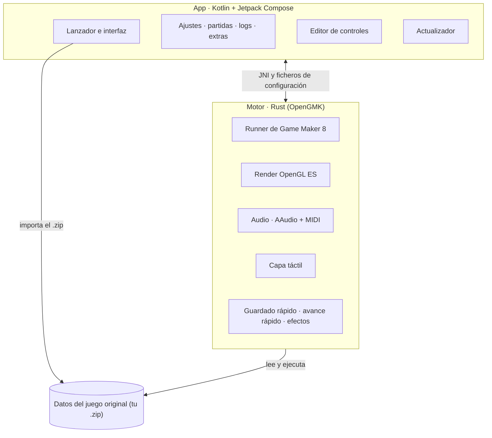

La app y el motor son dos mundos separados que se comunican por JNI y mediante ficheros de
configuración en el almacenamiento privado. El motor no sabe de interfaz: solo ejecuta el juego. La
app no sabe de Game Maker: solo lo lanza y lo envuelve. Esa separación permite tocar la interfaz sin
romper el motor, y viceversa.

| Capa | Tecnología |
| --- | --- |
| Interfaz | Kotlin, Jetpack Compose, Material 3 Expressive, Google Sans Flex |
| Motor | Rust sobre OpenGMK (`gm8emulator`, `gm8exe`) |
| Vídeo | OpenGL ES con EGL propio |
| Audio | AAudio por FFI + `rustysynth` para MIDI |
| Entrada | Capa táctil propia, mandos de Android, vibración |
| Empaquetado | Gradle 9.4.1 · AGP 9.2.1 · `minSdk 29` · `targetSdk 36` · `compileSdk 37` |

## Estructura del repositorio

```
.
├── android/                 App Android (Kotlin / Compose)
│   └── app/src/main/
│       ├── java/com/ahjin/pr/   Lanzador, ajustes, editor de controles, copias, diagnóstico, actualizador
│       ├── (src/test)           Pruebas JVM: copias de seguridad, diseños y temas
│       ├── assets/              Sprites de botones, SoundFont, diseño por defecto de los controles
│       └── res/                 Tema, tipografía e iconos
├── docs/screenshots/        Capturas de pantalla del README
├── src/OpenGMK/             OpenGMK con las modificaciones para Android
│   ├── gm8emulator/             Motor: runner, render, audio, capa táctil, extras
│   ├── gm8exe/                  Lector de ejecutables GM8 (+ ejemplos de diagnóstico)
│   └── …
├── vendor/                  Dependencias de ventana y sesión adaptadas (`ramen`, `udon`)
├── patches/                 Parches respecto a OpenGMK, para poder revisarlos
├── tools/                   Utilidades (generador del diseño de controles)
└── LICENSE                  GPL-2.0
```

## Compilar desde el código

### Requisitos

- **Rust** estable con los destinos `aarch64-linux-android` y `armv7-linux-androideabi`
  (`rustup target add …`).
- **Android NDK r27c**.
- **JDK 21** y **Gradle 9.4.1**.
- **Android SDK** con la plataforma 37 y sus licencias aceptadas.

### 1. El motor (`libgm8emulator.so`)

Se compila con el enlazador del NDK para API 29. Con `cargo-ndk`:

```bash
cd src/OpenGMK
cargo ndk -t arm64-v8a -t armeabi-v7a --platform 29 build -p gm8emulator --release
```

O directamente con Cargo, apuntando el enlazador al NDK (ejemplo para arm64):

```bash
export NDK=/ruta/al/android-ndk-r27c
export TC=$NDK/toolchains/llvm/prebuilt/linux-x86_64/bin
export CC_aarch64_linux_android=$TC/aarch64-linux-android29-clang
export AR_aarch64_linux_android=$TC/llvm-ar
export CARGO_TARGET_AARCH64_LINUX_ANDROID_LINKER=$TC/aarch64-linux-android29-clang

cd src/OpenGMK
cargo build --release --target aarch64-linux-android -p gm8emulator --lib
```

La biblioteca resultante debe quedar en `src/OpenGMK/target/<triple>/release/libgm8emulator.so`;
Gradle la copia a `jniLibs` antes de empaquetar y se niega a continuar si falta la de arm64 o si
algún `.so` no es un ELF válido. La de 32 bits es opcional.

> La compilación del motor solo está pensada para los destinos Android: `cargo check` en un
> ordenador de escritorio no funciona por dependencias de audio nativas.

### 2. La aplicación

```bash
cd android
./build.sh :app:assembleRelease      # o `gradle :app:assembleRelease`
```

Las pruebas de la parte Kotlin (copias de seguridad, diseños, temas) se lanzan con
`gradle :app:testDebugUnitTest`. Las del motor que no dependen de la ventana (`touch_controls.rs`,
`extras.rs`) se pueden ejecutar con `cargo test` en un crate de prueba que incluya esos dos módulos,
porque el crate completo de `gm8emulator` solo compila para Android.

El APK queda en `android/app/build/outputs/apk/release/`. Con Gradle se necesitan unos 2 GB de
memoria para el proceso; en equipos justos conviene tener swap.

## Firma y actualizaciones

Las versiones publicadas se firman con una **clave de release propia**. La clave nunca se sube al
repositorio: `android/keystore/` y `android/keystore.properties` están en `.gitignore`.

Para firmar tu propia compilación, crea `android/keystore.properties`:

```properties
storeFile=keystore/mi-clave.jks
storePassword=…
keyAlias=…
keyPassword=…
```

Sin ese archivo, Gradle firma con la clave de depuración. **Una compilación firmada con otra clave no
puede instalarse encima de la oficial**, y la app rechaza actualizarse con un APK cuyo paquete o
firma no coincidan con los de la instalada.

El actualizador consulta `releases/latest` de este repositorio (las prereleases se ignoran), toma el
primer asset `.apk`, compara versiones numéricamente y entrega el archivo al instalador del sistema
mediante un `FileProvider`.

## Herramientas de diagnóstico

Pequeños programas de apoyo en `src/OpenGMK/gm8exe/examples/`. Se ejecutan en un PC sobre el `.exe` del juego:

```bash
cd src/OpenGMK
cargo run --release -p gm8exe --example roomspeed -- "juego.exe"            # room_speed de cada room
cargo run --release -p gm8exe --example memstats  -- "juego.exe"            # qué ocupan los recursos
cargo run --release -p gm8exe --example dumpgml   -- "juego.exe" gml.txt    # vuelca todo el GML a texto
```

Además, `tools/generate-layout.py` regenera el diseño por defecto de los controles táctiles
(`android/app/src/main/assets/controls-layout.json`).

## Historial de versiones

| Versión | Novedades |
| --- | --- |
| **0.7.4** | **Descargar va al enlace del juego, y instalar encima no toca tus partidas.** El botón **Descargar** ya no abre la última entrada del blog (que a veces es solo una noticia sin enlace): busca la entrada más reciente que trae el juego y abre directamente su enlace de MEGA (con el de Gofile como alternativo), con el número de versión de esa descarga. Se ignoran la carpeta de librerías y los parches «Delta». Al **importar o abrir con** un zip del juego sobre uno ya instalado, tus **partidas, equipos y personajes** se copian a la instalación nueva antes del cambio (si un slot existe en los dos, se queda el tuyo), y el juego anterior solo se retira cuando el nuevo está colocado: si algo falla, no se pierde nada. La copia de seguridad previa se sigue haciendo. |
| **0.7.3** | **Abrir el `.zip` directamente desde el administrador de archivos:** mantén pulsado el zip y elige **Abrir con → Pokemon Reloaded** (o **Compartir**). La app mira dentro del zip y te pregunta qué hacer según lo que trae: instalar o reemplazar el juego, restaurar partidas, equipos y personajes, o poner una partida suelta en el slot que elijas. No cambia nada hasta que confirmas, y el progreso sigue aunque gires el móvil. |
| **0.7.2** | **Solo los botones necesarios en cada pantalla:** la mochila, el mapa, el equipo Pokémon, los datos del entrenador, la Pokédex, el móvil, las opciones, las misiones y las tiendas (comprar, vender, canjear y el PC) dejan de mostrar los botones del mundo; quedan el joystick, **Z** y **X**, más **C** donde sirve para ordenar la lista o mover el cursor del mapa. Los botones se mueven en Posición y tamaño de los botones > pestaña **Pantallas**. |
| **0.7.1** | **Corrección de dos fallos de la 0.7.0:** con la tabla de tipos abierta el juego ahora **se detiene por completo** (el rival ya no ataca mientras la miras; también se cierra con cualquier botón del mando) y los **atajos de Android** ya abren el juego (fallaban al arrancarlo desde fuera de una actividad, y la app se cerraba). |
| **0.7.0** | Cinco funciones nuevas, todas **opcionales y apagadas por defecto**: **velocidad ajustable** (cámara lenta ×0,5 y ×0,75, además de ×1,5, ×2, ×3 y ×4), **tabla de tipos** en combate (la imagen de efectividades del propio juego, sin salir de la partida), **correr fijo** (un toque deja X pulsada y otro la suelta, y se libera sola al abrir un menú, un diálogo o un combate), **botón turbo** (mantenerlo pulsa Z unas 7 veces por segundo) y **atajos de Android** al mantener pulsado el icono (Continuar y Cargar guardado rápido). Se añaden desde Posición y tamaño de los botones > Botones especiales; los botones propios ganan un modo (normal, turbo, fijo) y la pantalla de Diálogos. |
| **0.6.4** | **Z y X vuelven a ser letras** en todas las pantallas. Los dibujos de los botones se ven más nítidos: cada pixel del dibujo ocupa un número entero de pixeles de pantalla y el dibujo se alinea a la cuadrícula, con contorno oscuro si le falta y colores algo más vivos. La mochila es la **mochila roja con Poké Ball de la pantalla de objetos del juego**; el disquete y el regalo también son del juego. |
| **0.6.3** | Los botones que el juego no tiene dibujados (acción, correr, huir, emoticonos, hablar, objeto asignado, cambiar, menú, guardar, cargar y avance rápido) llevan **iconos pixel-art de la app, pintados con el estilo del juego** (contorno oscuro y luz arriba a la izquierda). Esc usa la flecha de volver del propio juego. |
| **0.6.2** | Los botónes usan el **arte del propio juego** donde existe: bici, caña, mapa, bola, Mega-Aro, reloj, lupa del Pokédex, mochila, equipo, medalla y disco de MO. Las imágenes se leen del juego ya instalado en el móvil al arrancarlo (no se incluyen en la app); si falta alguna, el botón conserva su icono dibujado. |
| **0.6.1** | Los botones del juego muestran un **icono de su función** (mochila, mapa, bici, caña, huir…) en lugar de la letra, con opción para volver a las letras. 16 iconos nuevos, también disponibles para los botones propios. |
| **0.6.0** | **Copias de seguridad** automáticas y manuales de las partidas (restaurar, compartir, borrar), **informe de diagnóstico** de un toque, **guía de uso** en la app, cinco **colores de acento** y **negro puro AMOLED**, **iconos** para botones propios y **preajustes** de disposición (zurdo, compacto, grande), y nuevos atajos de mando (FPS y cambio de ranura). Pruebas automáticas nuevas. |
| **0.5.0** | Paquete propio **`com.ahjin.pr`** y firma de release propia. Tema **«Obsidiana y oro»** con ajuste de apariencia (oscuro, claro, sistema), botón Jugar dorado, barra y listas con filete fino, icono nuevo. Corregido el autofrenado del **avance rápido**. Nuevo ejemplo `roomspeed`. README reescrito. |
| **0.4.0** | Guardado rápido (3 ranuras), avance rápido x2/x3/x4, botones propios y diseños guardados, escala de píxeles perfectos, rejilla LCD y CRT, indicador de FPS/memoria, ahorro de batería, vibración y atajos de mando, soporte armeabi-v7a, actualizador apuntando a este repositorio. |
| **0.3.1-mejorado.4** | Joystick de 8 direcciones en todo el juego. |
| **0.3.1-mejorado.3** | Joystick de 8 direcciones en combate. |
| **0.3.1-mejorado.2** | Controles con aspecto nativo, editor de posiciones y tamaños, ajustes de audio. |
| **0.3.1-mejorado.1** | Audio reescrito (sin cortes), mejoras de memoria y rendimiento, primeras mejoras de controles. |
| **0.3.1** | Versión de partida: port original de [@Klisee](https://github.com/Klisee/pokemon-reloaded-android). |

Cada versión, con su APK, está en [Releases](../../releases).

## Estado y problemas conocidos

- Desarrollado y probado en un **RedMagic 8S Pro** (Snapdragon 8 Gen 2, Android 13, arm64). También se ha
  probado en un **Samsung Galaxy S21 5G** y en un **Samsung Galaxy A53 5G**.
- El motor de **32 bits (armeabi-v7a)** se compila y empaqueta, pero no se ha probado en ningún móvil de 32 bits.
- El **guardado rápido** es una función experimental. Si algo falla, el log lo registrará.
- **Abrir con** (0.7.3) se ha probado con pruebas automáticas sobre zips de ejemplo, pero no en
  todos los administradores de archivos: cada uno describe el zip a su manera. Si el tuyo no muestra la
  app al mantener pulsado el zip, usa **Compartir** o el botón **Importar**, y cuéntanos cuál es.
- Los **botones por pantalla** de la 0.7.2 se han comprobado en el móvil con la mochila y el equipo; las
  demás pantallas (tiendas, Pokédex, móvil, misiones…) se detectan por los datos del propio juego, pero
  no se han recorrido una a una. Si alguna enseña botones de más o de menos, abre un log desde
  **Ajustes → Logs**: registra la pantalla que detecta en cada momento.
- Los **atajos de Android** y la tabla de tipos se corrigieron en la 0.7.1; si algo falla, comparte el
  informe de diagnóstico.
- Las minijuegos (casino, cartas, tragaperras) todavía no tienen botones propios.
- La app sigue en desarrollo y puede fallar. Si ocurre, guarda un log desde **Ajustes → Logs** y
  abre un [issue](../../issues) con él.

Problemas ya resueltos en el camino:

- Pantalla negra en móviles con GPU PowerVR (MediaTek Helio y similares), gracias al arreglo de
  Alexpix0 (ver créditos).
- Escalado de cámara en combate, el movimiento Vuelo, la XP infinita al abrir la mochila tras
  debilitar a un Pokémon y el cierre en combates dobles al cambiar de Pokémon.
- Cortes de audio al mezclar música y efectos.

Ideas para más adelante:

- Imágenes propias (pixel art) para más botones táctiles.
- Botones propios para las minijuegos.
- Revisar la compatibilidad con mandos de todo tipo.

## Licencia y créditos

Este proyecto se distribuye bajo la licencia **GNU GPL v2** (consulta [`LICENSE`](LICENSE)), la misma
que OpenGMK, de la que deriva.

- **Pokémon Reloaded** es obra de **F3R Productions**: [blog del juego](https://pokemon-reloaded.blogspot.com/).
- **[OpenGMK](https://github.com/OpenGMK/OpenGMK)**: la reimplementación del motor de Game Maker 8 sin la que este proyecto no existiría.
- **[@Klisee](https://github.com/Klisee)**: autor del port original a Android
  ([pokemon-reloaded-android](https://github.com/Klisee/pokemon-reloaded-android)), base de este trabajo.
- **Alexpix0 (Armando)**: arreglo del renderizado que resolvió la pantalla negra en GPU PowerVR (enlazar
  VAO/VBO/programa en cada dibujo, no invalidar el búfer, corregir el `std140` del bloque de uniforms y subir
  los atlases por lotes). [Su PR](https://github.com/Klisee/pokemon-reloaded-android/pull/2).
- **Google Sans Flex**, la tipografía de la aplicación, bajo licencia OFL.

Pokémon es una marca de Nintendo, Game Freak y Creatures. Este proyecto es un trabajo de fans, sin
ánimo de lucro, y no está afiliado ni respaldado por ellos.
