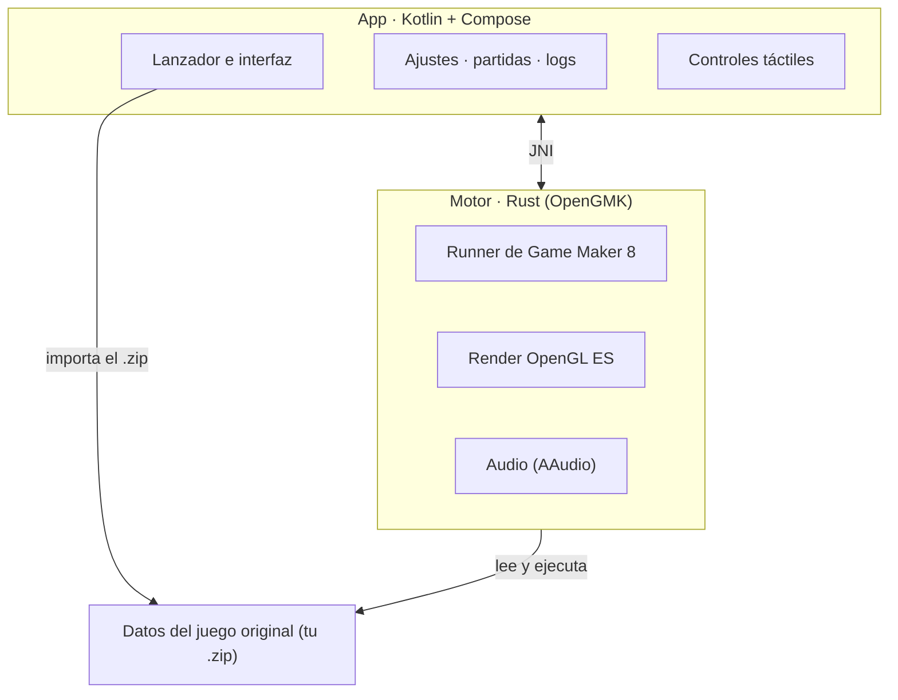

# Pokémon Reloaded en Android

Ejecuta **Pokémon Reloaded** en Android sin emulador de Windows de por medio.

Este repositorio es una versión mejorada del port de [@Klisee](https://github.com/Klisee)
([pokemon-reloaded-android](https://github.com/Klisee/pokemon-reloaded-android)), que a su vez se apoya en
[OpenGMK](https://github.com/OpenGMK/OpenGMK). Todo el código se distribuye bajo **GPL-2.0** (ver `LICENSE`).
Las versiones se descargan de la página de [Releases](../../releases); la app las busca aquí sola.
El juego en sí (Pokémon Reloaded) **no** está incluido: lo importas tú desde un `.zip`.

## Qué es esto, en realidad

Lo de "port" es un decir, y conviene aclararlo. Pokémon Reloaded es un juego hecho en Game Maker 8
para Windows, y aquí **no se ha reescrito ni recompilado nada**. Lo que hace esta app es
**ejecutar el juego original tal cual**, con sus archivos intactos, sobre
[OpenGMK](https://github.com/OpenGMK/OpenGMK): una reimplementación nativa en Rust del motor de
Game Maker 8.

Dicho de otro modo: no hay Wine, no hay Windows emulado, no hay capa de traducción. El motor está
escrito para Android y compilado para el móvil, así que el juego corre prácticamente como un nativo.
Lo único que se ha "porteado" son las tripas del motor, no el juego.

La app sí aporta todo lo de fuera del juego: importar el juego desde un `.zip`, controles táctiles,
ajustes, gestión de partidas y logs. El juego en sí no se toca.

## Cómo funciona

- **Importar.** Le das a Importar y eliges el `.zip` del juego. La app lo descomprime en su propio
  almacenamiento privado, así que no depende de permisos de almacenamiento ni de dónde lo tengas
  guardado.
- **Ejecutar.** El motor (OpenGMK, en Rust) se carga como librería nativa y arranca el runner de
  Game Maker 8 sobre los datos del juego. El render va por OpenGL ES y el audio por AAudio.
- **Controles.** La capa táctil no es fija: cambia según el estado del juego, así que en el mapa
  tienes una cruceta y en los menús otra cosa. Cada botón pulsa una tecla del juego, y puedes
  reasignar cualquiera desde Ajustes → Mando → Controles. También funciona un mando real, detectado solo.
- **Partidas.** Se leen y escriben en la carpeta del juego. Desde Ajustes → Partidas puedes verlas,
  exportarlas, importarlas, borrarlas y mover una de una ranura a otra. Si jugabas en PC, tu partida
  entra por aquí.
- **Salir y volver.** Al mandar la app a segundo plano, el bucle se detiene y el audio se corta de
  verdad; al volver, sigue donde estaba en vez de quedarse en negro.
- **Logs.** Si algo va mal, la app escribe un log y lo puedes compartir como archivo de texto desde
  Ajustes → Logs, sin perderlo al reiniciar el móvil.

## Extras de la 0.4.0

Todo esto se configura en Ajustes → Extras (y la escala, en Ajustes → Resolución). **No he podido
probarlo en un móvil de verdad**: está compilado y las partes que se pueden comprobar sin móvil están
comprobadas, pero si algo falla, el log (Ajustes → Logs) lo dirá.

- **Guardado rápido** (experimental): tres ranuras. Un botón guarda toda la partida y otro la
  devuelve (hay que pulsarlo dos veces seguidas, para no perder el progreso por un toque sin querer).
  Es independiente del guardado del propio juego. No guarda los sonidos (son datos fijos): la música
  en bucle vuelve a empezar al cargar. El archivo se escribe aparte y se renombra, así que un fallo
  nunca estropea la ranura anterior.
- **Avance rápido** x2, x3 o x4, con el sonido silenciado si quieres. Solo acorta la espera entre
  fotogramas: la lógica del juego no cambia. Se desactiva solo si el móvil se calienta mucho.
- **Botones propios**: hasta 8, con la tecla, el texto (3 letras) y las pantallas que elijas, y
  **diseños guardados** con nombre en el editor de posiciones.
- **Botones que se difuminan** cuando no tocas la pantalla (siguen funcionando).
- **Imagen**: escala de **píxeles perfectos** (múltiplos enteros), filtro suave opcional, rejilla LCD o
  líneas CRT, y respeto de la cámara/muesca.
- **FPS, tiempo por fotograma y memoria** en una esquina, y **ahorro de batería** (manual, o
  automático con el ahorro del sistema o el móvil caliente).
- **Mando**: vibración al pulsar y atajos propios (guardado rápido, cargar, avance rápido).
- **armeabi-v7a**: el APK lleva también el motor de 32 bits (sin probar en ningún móvil de 32 bits).

Probado a medias: el análisis del formato de `extras.conf` y de los botones propios se probó en el
ordenador; el resto, no. Una **caché de sprites** se descartó tras medir: leer y decodificar todo el
`.exe` del juego tarda menos de un segundo en un PC, y el atlas ya montado ocupa 256 MB, así que
guardarlo en disco sería más lento que volver a generarlo.

## Cómo está montado



La app y el motor son dos mundos separados que hablan por JNI. El motor no sabe de Android ni de
interfaz: solo sabe ejecutar el juego. La app no sabe de Game Maker: solo lo lanza y lo envuelve.
Esa separación es la que permite tocar la interfaz sin romper el motor, y viceversa.

## Qué necesitas

Los archivos originales del juego, que están en el blog de **F3R**:
[pokemon-reloaded.blogspot.com](https://pokemon-reloaded.blogspot.com/)

El repo no incluye ningún asset del juego, y eso es justo lo que lo mantiene limpio.

## Cómo se usa

1. Instala el APK de la última release.
2. Consigue el juego en un `.zip` y dale a **Importar** (o usa **Descargar** para abrir el blog).
3. **Jugar**. Si ya tenías partida en el PC, tráela desde Ajustes → Partidas.

## Estado

Está en beta y se nota: puede petar. Si algo falla, guarda un log desde Ajustes → Logs y ábrelo como
issue.

Ya resuelto:

- **La pantalla negra en móviles con GPU PowerVR** (MediaTek Helio y similares). El motor enlazaba el
  VAO/VBO/programa una sola vez y daba por anulado el búfer tras cada dibujo: en GPUs diferidas
  (TBDR) eso dejaba al procesador de vértices leyendo memoria descartada y no se pintaba nada. Ahora
  se enlazan en cada dibujo, no se invalida el búfer, el bloque de uniforms `std140` tiene los
  offsets correctos y los atlases se suben por lotes — con esto último el arranque pasó de ~85 s a
  un momento. Gracias a **Alexpix0 (Armando)**, que lo encontró y probó. (Los detalles del
  diagnóstico están en el historial de commits.)
- **El escalado en combate**, que se quedaba con la cámara descolocada.
- **El movimiento Vuelo**, que no llegaba a conectar.
- **La XP infinita** al abrir la mochila tras debilitar a un Pokémon.
- **El cierre en combates dobles** al cambiar de Pokémon.

Cambios de esta rama (`pokemon-reloaded-android-mejorado`, sin probar aún en todos los móviles):

- **Audio**: la mezcla va en su propio hilo y el callback de AAudio solo copia desde un buffer circular
  de ~60 ms, así que ya no se corta al mezclar música y efectos. Si hay huecos, se cuentan en el log
  (`[aaudio] N huecos de audio`). Los sonidos con frecuencia rara (los gritos) se preparan al cargar el
  juego y no al sonar, y se retiró el modo de rendimiento sostenido, que limitaba los relojes del móvil.
- **Controles táctiles con aspecto nativo** (v0.3.1-mejorado.2): botones translúcidos con borde suave,
  letras e iconos vectoriales, animación al pulsar y brillo del color de cada botón. Se puede volver al
  pixel art en Ajustes → Aspecto de los controles. **Editor de posiciones** en Ajustes: arrastra, cambia
  el tamaño u oculta cada botón por pantalla del juego; se guarda en `files/layout.conf`
  (`tools/generate-layout.py` regenera las posiciones de origen).
- **Controles táctiles más nativos**: vibración al tocar (apagada / ligera / fuerte), deslizar el dedo de
  un botón a otro sin levantarlo, joystick flotante opcional que sigue al pulgar, zona muerta ajustable,
  joystick de 8 direcciones (diagonales con histéresis), tamaño de los botones ajustable y
  los bordes de la pantalla excluidos del gesto «atrás» del sistema.
- **Rendimiento**: aviso de 30 fps al compositor (`ANativeWindow_setFrameRate`), sesión de
  `PerformanceHintManager` (ADPF) con la duración de cada frame con un objetivo del 70 % del frame.
- **Memoria**: tras cargar el juego y al pasar a segundo plano se devuelve al sistema lo que el
  asignador retiene (`mallopt` M_PURGE); el log muestra `[mem] ... MB -> ... MB`. Con
  `gm8exe/examples/memstats.rs` se mide qué ocupan los recursos del juego.

Lo que ahora mismo da problemas, y resolveré después:

Y por ir haciendo, sin orden:

- Poner imágenes propias (pixel art) a más botones táctiles.
- Más ajustes de rendimiento en móviles modestos.
- Revisar la compatibilidad con mandos de todo tipo.

## Compilar

```
# El motor (Rust) y su .so para Android
cd src/OpenGMK
cargo ndk -t arm64-v8a --platform 29 build -p gm8emulator --release

# La app
cd ../../android
./build.sh :app:assembleRelease
```

## Créditos

- **Pokémon Reloaded** es obra de **F3R Productions**: [el blog del juego](https://pokemon-reloaded.blogspot.com/)
- **OpenGMK**, la reimplementación del motor sin la que esto no existiría: [github.com/OpenGMK/OpenGMK](https://github.com/OpenGMK/OpenGMK)
- **Alexpix0 (Armando)**: por el arreglo del renderizado que resolvió la **pantalla negra en móviles con GPU PowerVR** (enlazar VAO/VBO/programa en cada dibujo, quitar la invalidación del búfer que rompía en GPUs diferidas, corregir el `std140` del bloque de uniforms y subir los atlases por lotes, que además dejó el arranque muchísimo más rápido). [Su PR](https://github.com/Klisee/pokemon-reloaded-android/pull/2)
- **Google Sans Flex**, la tipografía de la app

Pokémon es una marca de Nintendo, Game Freak y Creatures. Este proyecto no está afiliado ni
respaldado por ellos.
